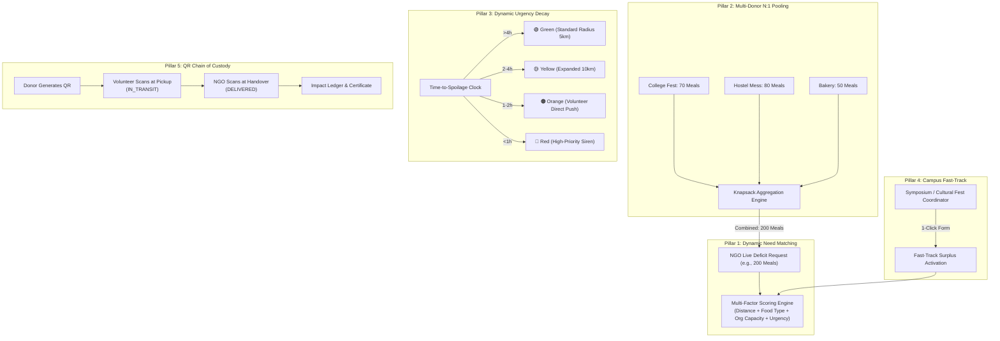
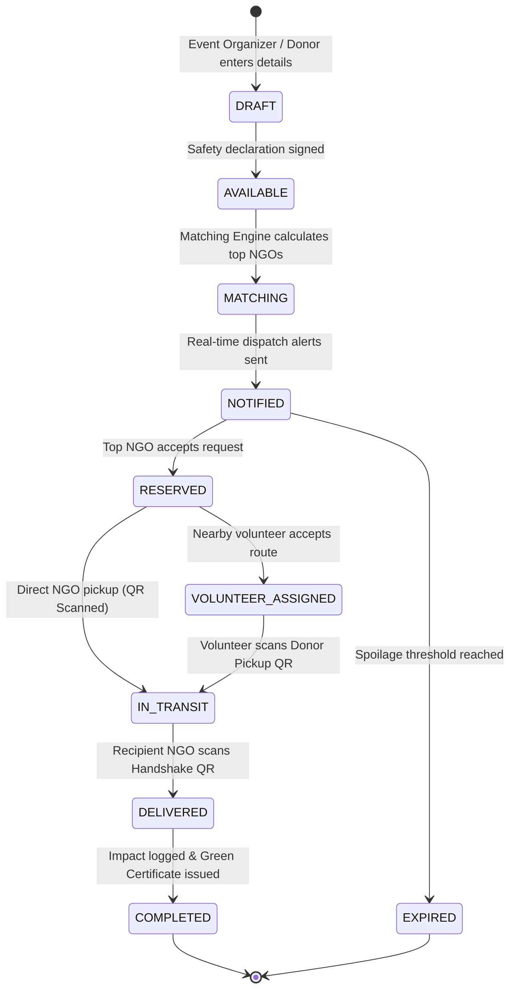
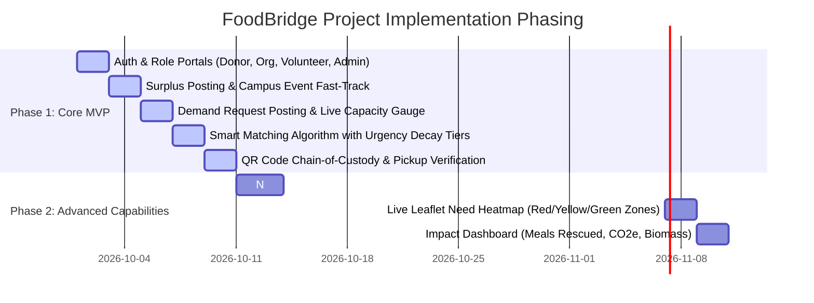

# 🍱 FoodBridge: Smart Food Rescue & Need-Matching Logistics Network
## Master Project Specification, Technical Blueprint & Academic Defense Report

---

# 1. 📌 Project Identity & Overview

| Field | Description |
| :--- | :--- |
| **Project Title** | **FoodBridge: A Hyperlocal, Event-Aware Surplus Food Rescue and Demand-Aggregation Platform with Multi-Stage Chain-of-Custody Verification** |
| **Domain** | Web Technologies, Cloud-Native Distributed Systems, GIS / Geo-Spatial Routing, Resource Allocation Algorithms |
| **Target Sector** | Institutional Catering (Colleges, Universities, Hostels), Commercial Food Services (Hotels, Restaurants, Bakeries), Humanitarian Relief Agencies (Food Banks, NGOs, Community Kitchens), Crowdsourced Logistics |
| **Primary Goal** | Minimize edible food waste and alleviate local food insecurity through an automated, real-time demand-driven matching and volunteer logistics network. |

---

# 2. 🎓 Executive Abstract & Problem Statement

### 2.1 Problem Statement
In urban and educational hubs, enormous volumes of freshly prepared, highly perishable food remain unused after college symposiums, cultural fests, hostel messes, banquet dinners, and restaurant shifts. Concurrently, hunger-relief organizations, community shelters, and food banks face chronic supply shortfalls and logistical barriers. 

Existing solutions fail due to three fundamental flaws:
1. **Static Directories & Ad-Hoc Messaging**: Platforms operate as static directories or rely on unorganized social chat groups (e.g., WhatsApp), causing severe communication delays and food spoilage.
2. **Strict 1:1 Matching Bottlenecks**: Global systems assume a single donor satisfies a single recipient, ignoring scenarios where a large shelter needs 200 meals, but individual local donors only have 50–80 meals each.
3. **Lack of Food Safety & Chain-of-Custody**: Without timestamped physical handshakes, organizers and donors fear legal liability or food mismanagement.

### 2.2 Project Abstract
**FoodBridge** resolves these challenges by introducing an end-to-end, intelligent coordination platform. Built around a **Demand-Driven Multi-Factor Matching Engine**, FoodBridge pools surplus from multiple donors ($N:1$ aggregation), calculates real-time **4-Tier Food Urgency Decay** to prevent spoilage, provides a **1-Click Campus Event Fast-Track** for educational institutions, visualizes a **Live GIS Food Need Heatmap**, and enforces a **Dual-Stage Cryptographic QR Chain-of-Custody**. This delivers an auditable, transparent, and high-impact logistics system tailored for campus pilots and municipal deployment.

---

# 3. 📊 Competitive Landscape & Academic Benchmark

| Feature / Dimension | **Olio** | **Too Good To Go** | **Food Rescue US** | **Food Rescue Hero** | **Replate** | **Feeding America** | **No Food Waste India** | **FoodBridge (Our Work)** |
| :--- | :---: | :---: | :---: | :---: | :---: | :---: | :---: | :---: |
| **Surplus Food Listing** | ✓ | ✓ | ✓ | ✓ | ✓ | — | ✓ | **✓** |
| **Food Donor Registration** | ✓ | ✓ | ✓ | ✓ | ✓ | — | ✓ | **✓** |
| **NGO / Recipient Registration** | ◐ | — | ✓ | ✓ | ✓ | ✓ | ✓ | **✓** |
| **Food-Bank / Pantry Finder** | ◐ | — | ✓ | ✓ | — | ✓ | ◐ | **✓** |
| **Volunteer Registration** | ✓ | — | ✓ | ✓ | ◐ | ◐ | ✓ | **✓** |
| **Volunteer Transport Logistics** | ✓ | — | ✓ | ✓ | ✓ | — | ✓ | **✓** |
| **Donor $\rightarrow$ Recipient Matching** | ◐ | — | ✓ | ✓ | ✓ | — | ✓ | **✓ (Multi-Factor Scoring)** |
| **Interactive GIS Map** | ✓ | ✓ | ✓ | ✓ | ✓ | ✓ | ✓ | **✓** |
| **Live Recipient Storage Capacity** | — | — | ✓ | ✓ | ◐ | ◐ | — | **✓ (Live Telemetry Gauge)** |
| **Perishability / Urgency Priority** | ◐ | ✓ | ◐ | ✓ | ◐ | — | ◐ | **✓ (4-Tier Decay Engine)** |
| **Multi-Donor $\rightarrow$ Single Requirement ($N:1$)** | — | — | — | ◐ | — | — | — | **✓ (Knapsack Aggregator)** |
| **Smart Volunteer Matching** | ◐ | — | ◐ | ✓ | ◐ | — | ◐ | **✓ (Vehicle-Aware)** |
| **Dual-Stage QR Chain-of-Custody** | — | ◐ | — | ◐ | — | — | — | **✓ (Donor + NGO QR)** |
| **End-to-End Status Tracking** | ✓ | ✓ | ✓ | ✓ | ✓ | — | ◐ | **✓ (Finite State Machine)** |
| **Carbon & Biomass Impact Telemetry** | ✓ | ✓ | ✓ | ✓ | ✓ | — | ✓ | **✓ (EPA $\text{CO}_2\text{e}$ Abatement)** |
| **Live Local Need Density Map** | — | — | — | ✓ | — | — | ◐ | **✓ (Demand Heatmap)** |
| **Campus / Event Fast-Track Mode** | ◐ | ◐ | ◐ | ◐ | ◐ | — | ✓ | **✓ (1-Click Fast-Track)** |

*Legend: ✓ = Full Native Capability, ◐ = Partial / Manual / Related Feature, — = Not a Core Capability.*

---

# 4. 🧠 The 5 Signature Technical Pillars



---

# 5. 📐 Mathematical Formulations & Engineering Algorithms

### 5.1 Multi-Factor Smart Matching Formula
When a donation $i$ is posted, every verified NGO $j$ within radius $D_{\max}$ (default $15\text{ km}$) receives a normalized Match Score $S_{ij} \in [0, 100]$:

$$S_{ij} = w_d \cdot f_{\text{dist}}(d_{ij}) + w_t \cdot f_{\text{urgency}}(\Delta T_{\text{rem}}) + w_c \cdot f_{\text{cap}}(Q_i, C_j) + w_p \cdot f_{\text{pref}}(P_i, R_j)$$

$$\text{Weights: } w_d = 0.35, \; w_t = 0.30, \; w_c = 0.20, \; w_p = 0.15 \quad (\sum w = 1.0)$$

1. **Distance Factor ($f_{\text{dist}}$)**:
   $$d_{ij} = 2R \arcsin\left(\sqrt{\sin^2\left(\frac{\Delta \phi}{2}\right) + \cos(\phi_i)\cos(\phi_j)\sin^2\left(\frac{\Delta \lambda}{2}\right)}\right)$$
   $$f_{\text{dist}}(d_{ij}) = \max\left(0, \; 1 - \frac{d_{ij}}{D_{\max}}\right)$$

2. **Time Decay / Urgency Factor ($f_{\text{urgency}}$)**:
   $$\Delta T_{\text{rem}} = t_{\text{expiry}} - t_{\text{now}}$$
   $$f_{\text{urgency}} = 1 - \min\left(1.0, \; \frac{\Delta T_{\text{rem}}}{T_{\text{shelf\_life}}}\right)$$

3. **Capacity Match ($f_{\text{cap}}$)**:
   $$f_{\text{cap}} = \min\left(1.0, \; \frac{C_j}{Q_i}\right)$$

4. **Dietary Compatibility ($f_{\text{pref}}$)**:
   $$f_{\text{pref}} \in \{0.0, 1.0\} \quad (\text{Strict match on Veg, Non-Veg, Halal, Cold Storage requirements})$$

---

### 5.2 Multi-Donor Resource Aggregation ($N:1$ Knapsack Heuristic)
When an NGO $j$ posts an unfilled demand for $D_j$ meals (e.g., $D_j = 200$), the engine finds an optimal subset of unreserved donations $\mathcal{S} = \{d_1, d_2, \dots, d_k\}$:

$$\min \left| D_j - \sum_{i \in \mathcal{S}} q_i \right| \quad \text{subject to} \quad \sum_{i \in \mathcal{S}} q_i \ge D_j \quad \text{and} \quad \forall i \in \mathcal{S}, \; \text{dist}(d_i, j) \le R_{\max}$$

The greedy approximation heuristic ranks candidate surplus donations by their **Rescue Urgency Index**:
$$\Phi(i) = \frac{q_i}{d(d_i, j) \cdot (\Delta T_{\text{rem}}(i) + 0.1)}$$

---

### 5.3 Live Spatial Need Heatmap ($H(x,y)$)
The spatial demand intensity displayed on the GIS map at coordinates $(x,y)$ is calculated as:
$$H(x, y) = \sum_{k \in \text{Unmet Demands}} \frac{\text{Deficit Meals}_k}{1 + \alpha \cdot \text{distance}^2((x,y), (x_k, y_k))}$$

---

# 6. 🏗️ System Architecture & Workflow State Machine



---

# 7. 🗄️ Complete Database Schema (PostgreSQL DDL)

```sql
-- =============================================================================
-- FoodBridge Enterprise Production DDL
-- =============================================================================
CREATE EXTENSION IF NOT EXISTS "uuid-ossp";

-- 1. CORE USER IDENTITIES & RBAC
CREATE TABLE users (
    id UUID PRIMARY KEY DEFAULT uuid_generate_v4(),
    email VARCHAR(255) UNIQUE NOT NULL,
    password_hash VARCHAR(255) NOT NULL,
    full_name VARCHAR(150) NOT NULL,
    phone VARCHAR(20) UNIQUE NOT NULL,
    role VARCHAR(30) NOT NULL CHECK (role IN ('donor', 'organization', 'volunteer', 'admin')),
    is_active BOOLEAN DEFAULT TRUE,
    created_at TIMESTAMP WITH TIME ZONE DEFAULT CURRENT_TIMESTAMP
);

CREATE TABLE user_addresses (
    id UUID PRIMARY KEY DEFAULT uuid_generate_v4(),
    user_id UUID NOT NULL REFERENCES users(id) ON DELETE CASCADE,
    address_label VARCHAR(100) DEFAULT 'Main Campus / Center',
    address_text TEXT NOT NULL,
    city VARCHAR(100) NOT NULL,
    latitude NUMERIC(10, 8) NOT NULL,
    longitude NUMERIC(11, 8) NOT NULL,
    is_default BOOLEAN DEFAULT TRUE
);

-- 2. ROLE PROFILES
CREATE TABLE donor_profiles (
    user_id UUID PRIMARY KEY REFERENCES users(id) ON DELETE CASCADE,
    donor_type VARCHAR(50) NOT NULL, -- 'college_canteen', 'event_organizer', 'restaurant', 'hotel', 'individual'
    institution_name VARCHAR(255),
    fssai_license VARCHAR(100),
    total_meals_donated INT DEFAULT 0
);

CREATE TABLE organization_profiles (
    user_id UUID PRIMARY KEY REFERENCES users(id) ON DELETE CASCADE,
    org_name VARCHAR(255) NOT NULL,
    org_type VARCHAR(50) NOT NULL, -- 'food_bank', 'ngo', 'shelter', 'community_kitchen'
    govt_reg_number VARCHAR(150),
    max_daily_capacity INT NOT NULL DEFAULT 250,
    current_occupancy INT DEFAULT 0,
    is_accepting_donations BOOLEAN DEFAULT TRUE,
    verification_status VARCHAR(30) DEFAULT 'verified',
    operating_hours_start TIME DEFAULT '08:00',
    operating_hours_end TIME DEFAULT '21:00'
);

CREATE TABLE volunteer_profiles (
    user_id UUID PRIMARY KEY REFERENCES users(id) ON DELETE CASCADE,
    transport_mode VARCHAR(30) DEFAULT 'two_wheeler', -- 'bicycle', 'two_wheeler', 'car', 'van'
    carrying_capacity_meals INT DEFAULT 50,
    is_available BOOLEAN DEFAULT TRUE,
    current_lat NUMERIC(10, 8),
    current_lng NUMERIC(11, 8),
    total_rescues INT DEFAULT 0,
    karma_points INT DEFAULT 100
);

-- 3. DEMAND SIDE (ORGANIZATION LIVE FOOD DEFICITS)
CREATE TABLE food_need_requests (
    id UUID PRIMARY KEY DEFAULT uuid_generate_v4(),
    organization_id UUID NOT NULL REFERENCES users(id) ON DELETE CASCADE,
    title VARCHAR(200) NOT NULL,
    meals_required INT NOT NULL,
    meals_fulfilled INT DEFAULT 0,
    food_category VARCHAR(50) NOT NULL, -- 'cooked_meals', 'raw_groceries', 'packaged'
    dietary_type VARCHAR(30) NOT NULL, -- 'vegetarian', 'vegan', 'non_veg', 'any'
    needed_by TIMESTAMP WITH TIME ZONE NOT NULL,
    latitude NUMERIC(10, 8) NOT NULL,
    longitude NUMERIC(11, 8) NOT NULL,
    status VARCHAR(30) DEFAULT 'open', -- 'open', 'partially_fulfilled', 'fulfilled', 'closed'
    created_at TIMESTAMP WITH TIME ZONE DEFAULT CURRENT_TIMESTAMP
);

-- 4. SURPLUS FOOD DONATIONS (WITH CAMPUS EVENT FAST-TRACK)
CREATE TABLE donations (
    id UUID PRIMARY KEY DEFAULT uuid_generate_v4(),
    donor_id UUID NOT NULL REFERENCES users(id) ON DELETE CASCADE,
    is_campus_event BOOLEAN DEFAULT FALSE,
    event_name VARCHAR(200),
    title VARCHAR(200) NOT NULL,
    food_category VARCHAR(50) NOT NULL,
    dietary_type VARCHAR(30) NOT NULL,
    quantity_meals INT NOT NULL,
    allocated_meals INT DEFAULT 0,
    weight_kg NUMERIC(6, 2),
    
    prepared_at TIMESTAMP WITH TIME ZONE NOT NULL,
    best_before TIMESTAMP WITH TIME ZONE NOT NULL,
    pickup_deadline TIMESTAMP WITH TIME ZONE NOT NULL,
    
    pickup_lat NUMERIC(10, 8) NOT NULL,
    pickup_lng NUMERIC(11, 8) NOT NULL,
    pickup_address TEXT NOT NULL,
    
    status VARCHAR(40) DEFAULT 'available', -- 'available', 'allocated', 'in_transit', 'delivered', 'expired'
    urgency_level VARCHAR(20) DEFAULT 'low_green', -- 'low_green', 'moderate_yellow', 'high_orange', 'critical_red'
    
    donor_pickup_code VARCHAR(6) NOT NULL,
    ngo_delivery_code VARCHAR(6) NOT NULL,
    qr_secret_token UUID DEFAULT uuid_generate_v4(),
    
    created_at TIMESTAMP WITH TIME ZONE DEFAULT CURRENT_TIMESTAMP
);

-- 5. N:1 PARTIAL ALLOCATIONS & DELIVERIES
CREATE TABLE donation_allocations (
    id UUID PRIMARY KEY DEFAULT uuid_generate_v4(),
    donation_id UUID NOT NULL REFERENCES donations(id) ON DELETE CASCADE,
    need_request_id UUID REFERENCES food_need_requests(id) ON DELETE SET NULL,
    organization_id UUID NOT NULL REFERENCES users(id),
    allocated_meals INT NOT NULL,
    status VARCHAR(40) DEFAULT 'allocated', -- 'allocated', 'in_transit', 'delivered'
    created_at TIMESTAMP WITH TIME ZONE DEFAULT CURRENT_TIMESTAMP
);

CREATE TABLE delivery_tasks (
    id UUID PRIMARY KEY DEFAULT uuid_generate_v4(),
    allocation_id UUID NOT NULL REFERENCES donation_allocations(id) ON DELETE CASCADE,
    volunteer_id UUID REFERENCES users(id),
    status VARCHAR(40) DEFAULT 'dispatched', -- 'dispatched', 'in_transit', 'completed', 'cancelled'
    pickup_verified_at TIMESTAMP WITH TIME ZONE,
    delivery_verified_at TIMESTAMP WITH TIME ZONE,
    created_at TIMESTAMP WITH TIME ZONE DEFAULT CURRENT_TIMESTAMP
);

-- 6. IMPACT LEDGER & TELEMETRY
CREATE TABLE impact_ledger (
    id UUID PRIMARY KEY DEFAULT uuid_generate_v4(),
    allocation_id UUID UNIQUE REFERENCES donation_allocations(id),
    meals_rescued INT NOT NULL,
    food_biomass_kg NUMERIC(8, 2) NOT NULL,
    co2e_kg_diverted NUMERIC(8, 2) NOT NULL, -- Formula: biomass_kg * 2.5
    created_at TIMESTAMP WITH TIME ZONE DEFAULT CURRENT_TIMESTAMP
);

-- 7. PERFORMANCE INDICES
CREATE INDEX idx_donations_geo ON donations(pickup_lat, pickup_lng);
CREATE INDEX idx_donations_urgency ON donations(urgency_level, status);
CREATE INDEX idx_need_geo ON food_need_requests(latitude, longitude, status);
CREATE INDEX idx_volunteers_avail ON volunteer_profiles(is_available, transport_mode);
```

---

# 8. 🌐 REST API Endpoints Specification

| Method | Endpoint | Access Role | Description |
| :--- | :--- | :--- | :--- |
| `POST` | `/api/v1/auth/register` | Public | Register user as Donor, Org, or Volunteer |
| `POST` | `/api/v1/auth/login` | Public | Authenticate user and issue JWT token with RBAC |
| `POST` | `/api/v1/donations` | Donor | Create surplus listing (supports `is_campus_event`) |
| `GET` | `/api/v1/donations/my` | Donor | List active and historical donations for donor |
| `POST` | `/api/v1/needs` | Organization | Post a food requirement/deficit for the heatmap |
| `GET` | `/api/v1/needs/heatmap` | Public / All | Get geospatial density points of active food requirements |
| `GET` | `/api/v1/donations/match-feed` | Organization | Fetch candidate donations ranked by the matching algorithm |
| `POST` | `/api/v1/donations/{id}/claim` | Organization | Claim donation (supports partial allocation quantity) |
| `GET` | `/api/v1/volunteers/routes` | Volunteer | Fetch available delivery manifests within radius |
| `POST` | `/api/v1/tasks/{id}/claim` | Volunteer | Volunteer claims delivery leg |
| `POST` | `/api/v1/tasks/{id}/verify-pickup` | Vol / Donor | Submit Donor QR / OTP to mark status as `IN_TRANSIT` |
| `POST` | `/api/v1/tasks/{id}/verify-delivery` | Vol / NGO | Submit NGO QR / OTP to complete delivery and log impact |
| `GET` | `/api/v1/analytics/impact` | Public / All | Real-time aggregate telemetry (Meals, kg, $\text{CO}_2\text{e}$) |

---

# 9. 🛡️ Food Safety & Legal Compliance Framework

1. **Good Samaritan Compliance**: The platform includes statutory non-liability terms protecting donors who act in good faith without negligence.
2. **Safe Handling Checklist**: Before activation, donors must verify:
   - Cooked food temperature maintained $>60^\circ\text{C}$ or chilled $<5^\circ\text{C}$.
   - Packaged and handled in clean, food-grade containers.
3. **90-Minute Expiry Buffer**: Cooked items with less than 90 minutes remaining before the safe deadline are flagged or expired to prevent food safety incidents.
4. **Automated Expiry Daemon**: Background worker automatically purges unaccepted donations whose deadline has passed.

---

# 10. 🛠️ Technology Stack

| Layer | Recommended Technology | Rationale |
| :--- | :--- | :--- |
| **Backend** | **Python 3.10+ (Flask / FastAPI)** | Fast development, rich data science/math libraries, easy algorithmic integration |
| **Database** | **PostgreSQL (or SQLite for local dev)** + SQLAlchemy | ACID compliance, JSON support, robust indexing, PostGIS capability |
| **Frontend** | **HTML5, Modern CSS (Tailwind / Bootstrap 5), Vanilla JS** | Lightweight, responsive across mobile browsers for volunteers and organizers |
| **Mapping / GIS** | **Leaflet.js + OpenStreetMap** | Free, open-source, interactive tile rendering with heatmaps and route polylines |
| **QR Code Engine** | **qrcode (Python) / html5-qrcode (JS)** | Fast client-side camera scanning and server-side QR token generation |

---

# 11. 🎓 Viva / Defense Strategy: Key Questions & Answers

### Q1: How is FoodBridge different from Robin Hood Army or Food Rescue US?
> **Answer**: *"Robin Hood Army relies on manual WhatsApp coordination, which introduces human latency for urgent cooked meals. Food Rescue US is built around pre-scheduled, 1:1 recurring corporate routes. FoodBridge is designed for bursty, time-critical campus/institutional environments with (1) $N:1$ knapsack pooling to combine multiple small donors, (2) an automated 4-tier urgency decay engine, and (3) dual-stage QR chain-of-custody for safety verification."*

### Q2: How does the Smart Matching algorithm work?
> **Answer**: *"It calculates a composite score from 0 to 100 based on Haversine travel distance (35%), time urgency remaining (30%), recipient daily capacity match (20%), and dietary compatibility (15%). Organizations with the highest score receive priority dispatch alerts."*

### Q3: How do you handle fake food postings or theft?
> **Answer**: *"We use a Dual-Stage Cryptographic Chain-of-Custody. The donor generates a unique dynamic QR token that the volunteer must scan at pickup. On delivery, the recipient NGO scans a second handshake QR token. Only when both physical handshakes are validated is the donation marked complete and credited to the impact ledger."*

---

# 12. 📋 2-Week Implementation Roadmap


